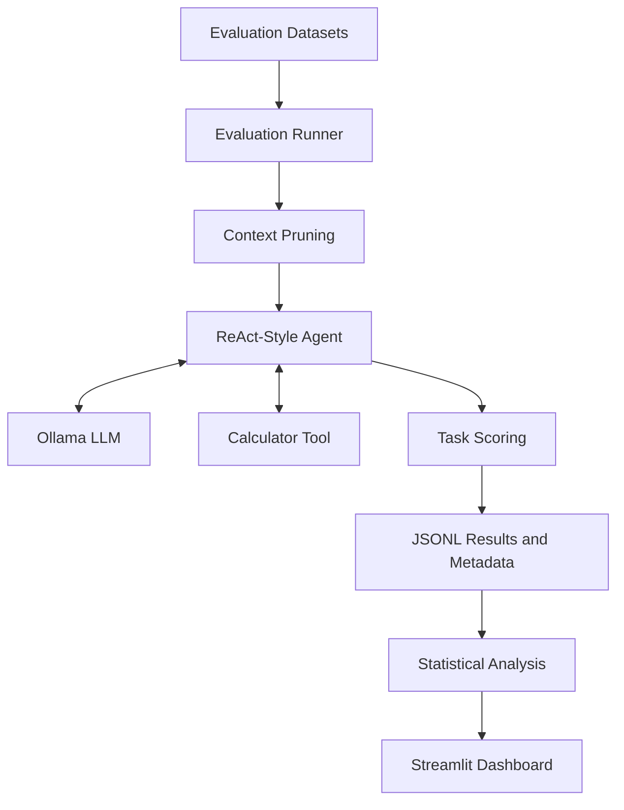

# Agentic LLM Evaluation Platform

A reproducible evaluation platform for comparing locally running Large Language Models (LLMs) on sentiment analysis, question answering, and tool-use tasks using Ollama.

The project evaluates model accuracy, response reliability, latency, context pruning, and failure patterns through a Streamlit dashboard.

## Key Features

- Compare multiple local LLMs using a common evaluation pipeline.
- Evaluate sentiment classification using SST-2.
- Evaluate question answering and abstention using SQuAD 2.0.
- Evaluate tool-use decisions using a synthetic, labelled dataset.
- Compare full context against Top-K context pruning.
- Measure accuracy, Exact Match (EM), F1 score, fabrication rate, and latency.
- Calculate confidence intervals and paired statistical comparisons.
- Explore failed scenarios and run provenance through a Streamlit dashboard.
- Store raw evaluation records in JSONL format for reproducibility.

## Models Evaluated

The platform supports the following Ollama models:

- `qwen2.5:3b`
- `llama3.2:3b`
- `qwen2.5-coder:3b`

A non-LLM baseline is also included for comparison.

## Technology Stack

| Technology | Purpose |
|---|---|
| Python | Evaluation pipeline and scoring |
| Ollama | Running LLMs locally |
| Streamlit | Interactive dashboard |
| Pandas | Results processing and tables |
| SciPy | Statistical testing |
| scikit-learn | Text processing and context selection |
| pytest | Automated testing |
| JSONL | Raw evaluation records |

## Evaluation Tasks

### 1. Sentiment Analysis

Uses a 100-example subset of the SST-2 validation dataset, containing 50 positive and 50 negative examples.

**Metrics:** Accuracy and output-format reliability.

### 2. Question Answering and Abstention

Uses 200 questions from SQuAD 2.0: 100 answerable and 100 unanswerable questions.

**Metrics:** Exact Match, token-level F1, correct abstention, fabrication rate, and groundedness.

### 3. Tool Use

Uses 40 synthetic labelled scenarios: 20 requiring calculator use and 20 that do not require a tool.

**Metrics:** Answer accuracy, tool-use correctness, and unnecessary tool calls.

## Context Pruning

The platform compares the use of the original context with a reduced context using Top-K sentence selection.

The default comparison uses `none` and `topk:2`.

This experiment measures context reduction, answer retention, and changes in model performance. Context pruning can reduce the amount of information passed to a model, but it can also remove evidence needed for a correct answer.

## Architecture



The agent follows a bounded ReAct-style loop. It generates structured actions, can call a calculator tool, receives tool observations, and produces a final answer. Invalid outputs can trigger a limited repair attempt.

This is a small evaluation agent, not a fully autonomous multi-agent system.

## Dashboard

The Streamlit dashboard contains five tabs:

1. **Leaderboard** — compares models across evaluation tasks.
2. **Context Pruning** — compares unpruned and pruned configurations.
3. **Latency** — displays response-time statistics.
4. **Failure Explorer** — inspects failed scenarios and agent execution details.
5. **Provenance** — displays run metadata and reproducibility information.

## Dataset Sources

- **SQuAD 2.0:** Question-answering dataset introduced by Rajpurkar et al. (2018).
- **SST-2:** Sentiment dataset originating from the Stanford Sentiment Treebank and used in GLUE.
- **Tool-use dataset:** A small synthetic dataset created for this project.

The project uses subsets rather than the full datasets. See `data/manifest.json` for dataset metadata and hashes. Check the original dataset licences and terms before redistributing the data.

## Requirements

- Python 3.10 or a compatible supported Python version
- [Ollama](https://ollama.com/)
- Git
- Required Python packages listed in `requirements.txt`

## Installation and Local Setup

Run these commands from the project directory.

### 1. Download the required models

Install and start Ollama, then run:

```bash
ollama pull qwen2.5:3b
ollama pull llama3.2:3b
ollama pull qwen2.5-coder:3b
```

### 2. Install Python dependencies

```bash
python -m pip install -r requirements.txt
```

### 3. Check model availability

```bash
python -m llm_eval.cli check
```

### 4. Run a small evaluation first

```bash
python -m llm_eval.cli run --limit 10
```

### 5. Run the full evaluation

```bash
python -m llm_eval.cli run
```

The runner supports resuming an interrupted run. Runtime depends on the computer, selected models, and inference settings.

### 6. Launch the dashboard

```bash
streamlit run app/dashboard.py
```

Open the local URL printed by Streamlit, usually:

`http://localhost:8501`

**Note:** The dashboard needs the evaluation results at the configured runs directory. If the project uses `results/full-benchmark`, make sure that folder exists and contains the JSONL records.

## Metrics Explained

| Metric | Meaning |
|---|---|
| Accuracy | Proportion of scenarios answered correctly |
| Exact Match (EM) | Whether a normalised answer exactly matches a gold answer |
| Token F1 | Overlap between predicted and gold answer tokens |
| Correct abstention | Whether the model declines to answer an unanswerable question |
| Fabrication rate | Rate of answering questions labelled unanswerable |
| Groundedness | Whether answer text appears in the supplied context, using the project's extractive check |
| Latency | Time taken to generate a response |
| Confidence interval | Uncertainty range around an estimated metric |
| McNemar's test | Paired comparison of binary outcomes on the same scenarios |

Failed, missing, or unparseable outputs are counted as failures in the overall success denominator. Completion and correctness are reported separately.

## Reproducibility

The project records evaluation outputs and metadata, including configuration and dataset hashes. It uses seeded sampling and controlled inference settings where supported.

Exact, bit-for-bit reproduction is not guaranteed across different Ollama versions, hardware, or model quantisations.

## Limitations

- Evaluation subsets are relatively small and can produce wide confidence intervals.
- The tool-use dataset is synthetic and contains only one calculator tool.
- Fabrication and groundedness metrics are task-specific proxies, not general-purpose hallucination detection.
- Top-K pruning is a simple lexical sentence-selection method.
- Phrase-based abstention detection may miss unusual paraphrases.
- Results depend on the models, prompts, quantisations, and hardware used.
- The project evaluates existing models; it does not train a new LLM.

## Testing

Run the automated tests with:

```bash
python -m pytest
```

## Current Results

Raw evaluation outputs are stored in `results/full-benchmark/` when the benchmark has been run.

Do not treat test-fixture results or simulated backend results as real model results. Report performance figures only after confirming that the corresponding records came from genuine Ollama inference runs.

## Future Improvements

- Expand the evaluation datasets.
- Add more tools and multi-step tasks.
- Validate LLM-as-judge metrics against human-labelled examples.
- Add further model backends.
- Improve context selection and evaluation coverage.

## Author

**Konjeti Sohith**

GitHub: [@konjetisohith](https://github.com/konjetisohith)
