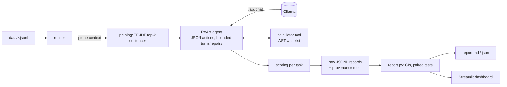

# Agentic LLM Evaluation Platform (local models via Ollama)

Reproducible evaluation of local LLMs on three agentic task families, run through the same ReAct-style
agent so models are compared fairly:

| Task | Data | What it measures |
|---|---|---|
| Sentiment | SST-2 validation subset (100 of the 872 standard dev sentences) | classification accuracy, output-format reliability |
| Question answering + abstention | SQuAD 2.0 dev subset (200 questions: 100 answerable, 100 unanswerable) | EM, F1, abstention, fabrication, groundedness |
| Tool use | synthetic, **labelled** set | answer accuracy, tool used when required, unnecessary calls |

Plus context pruning (on/off, paired comparison), non-LLM baselines, confidence intervals, a Streamlit
dashboard, and run provenance (commit, config hash, data hashes).

## Datasets (real, included, hash-verified)
| Data | Source | Subset | Verification |
|---|---|---|---|
| SQuAD 2.0 dev | official file from the SQuAD authors' GitHub repo | 200 questions (100 answerable / 100 unanswerable), seed 42 | SHA-256 pinned; 11,873 questions / 5,945 unanswerable match the published dev statistics |
| SST-2 validation | third-party GitHub mirror of the standard 872-sentence binary dev split | 100 sentences (50 pos / 50 neg), seed 42 | SHA-256 pinned; 444 pos / 428 neg match the published split; labels cross-checked against a second independent mirror (872/872 agree) |
| Tool-use set | synthetic, generated by `build_tool_set` | 40 (20 need the calculator, 20 do not) | arithmetic gold answers recomputed by the calculator in tests |

The subsets are already in `data/` (see `data/manifest.json`), so you can run immediately. `python -m llm_eval.cli prepare`
rebuilds them from the sources and refuses to continue if a hash or statistic no longer matches. The SST-2 file is a
GitHub mirror because the dev sandbox could not reach the GLUE zip; it is not byte-verified against GLUE's own file.
Use `prepare --source hf` to build from Hugging Face instead.
Citations: Rajpurkar et al. 2018 (SQuAD 2.0, CC BY-SA 4.0); Socher et al. 2013 (SST) and Wang et al. 2019 (GLUE).
Check each dataset's terms before redistributing.

## Status: what is and is not verified
| Item | Status |
|---|---|
| Agent loop, tools, scoring, stats, runner, report, dashboard | **Verified:** 32 automated tests pass, incl. a mutation check showing the regression test fails if the old denominator bug returns |
| Real datasets downloaded, hash- and statistic-checked, subsets built | **Verified** |
| Full pipeline on the real subsets (1,960 records, no truncation) | **Verified against a FAKE Ollama server** (scripted oracle, not a model): scoring handles real SQuAD/SST-2 strings correctly |
| Non-LLM baselines and pruning answer-retention on the real data | **Measured** (below) |
| Real Ollama inference, results for the 3 LLMs | **Not run.** No Ollama in the dev sandbox. You produce these on your laptop |
| Cloud LLM backends | **Not implemented** |

### Measured without any LLM (real data; see `results/measured_offline.md`)
| Baseline | Result |
|---|---|
| VADER lexicon on SST-2 subset | 69.0% accuracy [59-77], n=100 |
| Always-abstain on SQuAD 2.0 subset | 50.0% overall [43-57]; 100% on unanswerable, 0% on answerable |

An LLM only shows value if it beats these (the QA bar is 50% overall, not 0%).

| Pruning (top-k sentences) | Gold answer retained, all 5,928 answerable dev questions | Context removed |
|---|---|---|
| k=1 | 81.0% [80-82] | 75% |
| k=2 (default) | 92.3% [92-93] | 54% |
| k=3 | 96.4% [96-97] | 35% |
| k=4 | 98.3% [98-99] | 20% |

Retention caps how well any model can do on answerable questions after pruning: at k=2, at most about 92% are even answerable.

**There are no LLM results in this repo yet.** Do not quote any until you have run it yourself.

## Quick start (laptop)
```bash
# 1. install Ollama (https://ollama.com), then pull the models
ollama pull qwen2.5:3b && ollama pull llama3.2:3b && ollama pull qwen2.5-coder:3b

# 2. python deps
pip install -r requirements.txt

# 3. sanity check (datasets are already in data/; `python -m llm_eval.cli prepare` rebuilds them from source)
python -m llm_eval.cli check

# 4. small first run (10 scenarios per task), then the full run
python -m llm_eval.cli run --limit 10
python -m llm_eval.cli run                # resumes automatically if interrupted

# 5. dashboard
streamlit run app/dashboard.py
```
Defaults: 340 scenarios (100 SST-2 + 200 SQuAD + 40 tools); QA runs with `none` and `topk:2` pruning (add `--prune none topk:1 topk:2 topk:3`
for a sweep). Runtime depends heavily on your hardware: time `--limit 10` first and extrapolate (3 models x ~540 agent runs by default).
`data/fixtures` holds tiny hand-written examples for smoke tests only. Metrics are derived from raw records, so scoring fixes never
require re-running inference (`python -m llm_eval.cli report`).

## Architecture

**Agent behaviour:** one JSON action per turn (`calculator` or `finish`); invalid output gets a bounded repair
prompt; tool errors are returned as observations so the model can recover; every run ends in an explicit status
(`finished | parse_failure | turn_limit | backend_error`). It is a small ReAct loop, not an autonomous planner.
Be precise about that in interviews.

## Metric definitions (what the numbers mean)
- **success** = the answer is correct. Missing, unparseable, or failed runs count as failures; the denominator is always all scenarios.
- **completed** = the agent produced a final answer. *Completion is not correctness*; both are reported.
- **SST-2:** parsed label equals gold. `parse-fail` and `acc on parsed only` are shown so inflation from dropping bad outputs is visible.
- **SQuAD 2.0:** SQuAD-official normalization; EM/F1 = max over gold answers on answerable questions. Unanswerable questions are correct only if the model abstains (`UNANSWERABLE` or a listed phrase, see `tasks.py`).
- **fabrication** = answered an unanswerable question (primary hallucination measure). **ungrounded** = answer text not found in the original context (extractive groundedness only; not a general hallucination detector).
- **answer retained** = gold answer still present in the pruned context. If low, pruning removed the evidence.
- **Tools:** accuracy, tool used when required, unnecessary calls when not needed. Labels are synthetic.
- **Latency:** warm-up call first (load time excluded); p50/p95 and tokens/s reported. Compare only on the same machine.
- **Intervals:** Wilson (rates), bootstrap (means); pruning and model comparisons are paired (McNemar exact, paired bootstrap).
- **Baselines:** `baseline-rules` = VADER sentiment, always-abstain QA. Read every model against it.

## Reproducibility
temperature 0, fixed seed, explicit `num_ctx` (and a truncation flag), seeded data sampling, data file hashes,
git commit + config hash saved with each run. Ollama itself may not be bit-for-bit deterministic across versions or hardware.

## Known limitations
- ~100 scenarios per task gives wide intervals; scale up before drawing conclusions about small differences.
- Tool-use set is synthetic and small; one tool only (calculator).
- Hallucination measures are task-specific proxies, not a general detector.
- Context pruning is a simple lexical selector.
- Abstention detection is phrase-based and can miss unusual paraphrases.
- Results hold for these models, prompts, and Ollama quantizations only.

## Next steps
Larger samples and more models; LLM-as-judge validated against a human-labelled subset; multi-tool tasks; cloud backends (only after tested).
